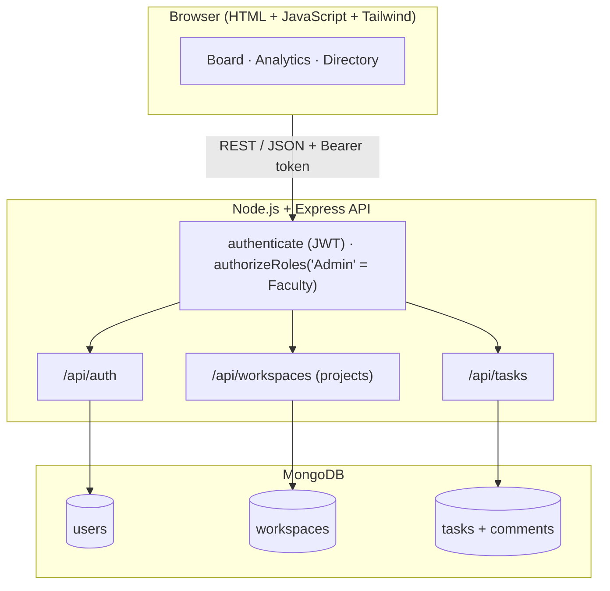
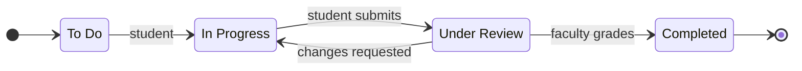

# CampusBoard: A Role-Based Collaborative Workspace for Academic Projects

CampusBoard brings the whole university project lifecycle into **one open-source workspace**. Today, student projects are scattered across Slack or WhatsApp (communication), GitHub (code), Google Drive (documents), spreadsheets (task tracking) and a generic LMS (grading). CampusBoard replaces that fragmentation with a single board where students track work, attach their repository and documents, discuss with their guide, and receive faculty review and grades.

| Problem (scattered tools) | CampusBoard feature |
| :--- | :--- |
| Task tracking in spreadsheets / chat | Kanban board: **To Do → In Progress → Under Review → Completed** |
| Code on GitHub, reports on Drive | **Repository and document links** attached to each task |
| Discussions lost in WhatsApp groups | **Comment thread** on every task |
| Faculty review by e-mail | **Under Review** column + faculty **grade (0–100) and feedback** |
| Grades kept in separate sheets | **Analytics**: average grade, review queue, student workload |
| Anyone can join with any e-mail | **Role by campus domain**, accounts created only by faculty |

---

## Roles

| Role | E-mail domain | Can do |
| :--- | :--- | :--- |
| **Faculty** | `*@faculty.campusboard.edu` | Create accounts and projects, enrol students, create/assign/edit/delete tasks, review and grade work, view analytics |
| **Student** | `*@student.campusboard.edu` | View enrolled projects, log progress, move tasks up to *Under Review*, attach repo/document links, comment |

Only faculty can mark work **Completed**, which happens when they submit a grade. Students cannot skip the review step.

---

## Open-source technology stack

| Layer | Technology | Licence |
| :--- | :--- | :--- |
| Runtime | Node.js | MIT |
| Web framework | Express 5 | MIT |
| Database | MongoDB Community Server | SSPL |
| ODM | Mongoose | MIT |
| Authentication | jsonwebtoken (JWT) | MIT |
| Password hashing | bcryptjs | MIT |
| Configuration | dotenv | BSD-2-Clause |
| Styling | Tailwind CSS | MIT |
| Charts | Chart.js | MIT |
| Icons | Bootstrap Icons | MIT |
| Containers | Docker / Docker Compose | Apache-2.0 |
| **CampusBoard itself** | — | **MIT** |

---

## Architecture



### Task lifecycle



---

## API reference

| Method | Endpoint | Access | Purpose |
| :--- | :--- | :--- | :--- |
| `POST` | `/api/auth/login` | Public | Sign in, returns JWT |
| `POST` | `/api/auth/provision` | Faculty | Create a student or faculty account |
| `GET` | `/api/auth/users` | Signed in | Campus directory |
| `GET` | `/api/workspaces` | Signed in | My projects |
| `POST` | `/api/workspaces` | Faculty | Create a project |
| `POST` | `/api/workspaces/:id/members` | Owner / Faculty | Enrol a student |
| `GET` | `/api/tasks/workspace/:id` | Project members | Tasks of a project |
| `POST` | `/api/tasks` | Project members | Create a task / progress log |
| `PATCH` | `/api/tasks/:id/status` | Project members | Move a task (only faculty can set *Completed*) |
| `PATCH` | `/api/tasks/:id/links` | Project members | Attach repository / document links |
| `PATCH` | `/api/tasks/:id/review` | Faculty | Grade (0–100) + feedback, marks Completed |
| `POST` | `/api/tasks/:id/comments` | Project members | Add a comment |
| `PUT` | `/api/tasks/:id` | Owner / Faculty | Edit task details |
| `DELETE` | `/api/tasks/:id` | Owner / Faculty | Delete a task |

---

## Getting started

### Option A: Node.js + MongoDB

```bash
npm install
cp .env.example .env        # then edit the values
npm run seed                # optional demo data (wipes the database first)
npm start                   # http://localhost:5000
```

### Option B: Docker

```bash
docker compose up --build   # app on http://localhost:5000 with its own MongoDB
docker compose exec app npm run seed   # optional demo data
```

### Demo accounts (after `npm run seed`)

| Role | E-mail | Password |
| :--- | :--- | :--- |
| Faculty | `meera.iyer@faculty.campusboard.edu` | `FacultyPass123!` |
| Student | `aarav.mehta@student.campusboard.edu` (and 5 others) | `StudentPass123!` |

> These are demo credentials for local use only. Change `JWT_SECRET` and the root password before deploying.

---

## Project structure

```text
campusboard/
├── config/db.js            # MongoDB connection helper
├── middleware/auth.js      # JWT authentication & role authorization
├── models/                 # User, Workspace (project), Task (+ comments, links, grade)
├── routes/                 # authRoutes, workspaceRoutes, taskRoutes
├── public/                 # signin, dashboard (board), analytics, members (directory)
├── seedData.js / seedAdmin.js
├── server.js               # entry point, static hosting, root faculty bootstrap
├── Dockerfile · docker-compose.yml
└── LICENSE · CONTRIBUTING.md · CODE_OF_CONDUCT.md
```

## Contributing

Pull requests are welcome! Please read [CONTRIBUTING.md](CONTRIBUTING.md) and our [Code of Conduct](CODE_OF_CONDUCT.md).

## Licence

Released under the [MIT Licence](LICENSE).
